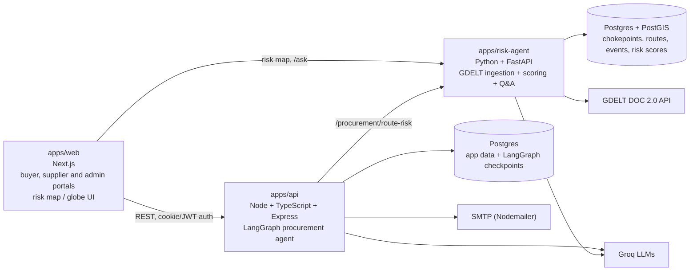

# AI Procurement & Supply Chain Risk Agent

An AI-assisted procurement platform. A buyer describes what they need in plain English, the agent finds supplier quotes, ranks fulfillment plans by price, lead time and deadline fit, and pauses for human approval before anything is ordered. A built-in risk analysis service shows whether the shipping lane between supplier and destination is affected by blockades, conflict or other disruption.

**Live app:** https://procurement-agent-web.vercel.app

---

## What it does

### 1. Sourcing agent (buyer)
- Takes a freeform request, e.g. *"We need 50 units of SanDisk Ultra 64GB microSD card for the hardware team by 2026-10-27."*
- Extracts line items, quantities and the required-by date with an LLM.
- Searches **registered suppliers** (the platform catalog), the **web**, or both.
- Scores every quote on price, lead time and deadline fit, with a **Prioritise** setting (balanced / cheapest / fastest).
- Converts prices to the buyer's currency using live FX rates and includes tax and shipping.
- Builds a **recommended fulfillment plan** (single supplier or split across suppliers) plus alternatives, with a plain-language rationale, e.g. *"Cheapest · fastest · arrives 12d before deadline"*.
- Optionally runs a **supply chain risk check** on the supplier regions in the plan.
- **Always stops for human approval.** The buyer approves the recommended plan, picks an alternative, or rejects.
- After approval, creates and emails RFQs to the chosen suppliers.
- Buyers can also place a **direct order** with a catalog supplier (cart checkout). The server prices it from the catalog, so the browser can never set its own price. See [Orders](#orders).

### 2. Supplier portal
- Suppliers register, build a public profile and manage their product catalog (price, MOQ, lead time, category, tax, certifications).
- They see confirmed orders and their status, and an inbox of RFQs to quote on.
- New suppliers can be reviewed by an admin before going live.

### 3. Route risk analysis
- The user picks an **origin and destination** (typed or on a world map / globe).
- The risk service reports status **per transport mode** (sea, air, road, rail): the chokepoints on the lane, their current risk level (green / yellow / red) and the news events behind it.
- It also answers natural-language questions about current risk (`/ask`).
- Risk data is **advisory**. It never blocks an order and does not change the quote ranking.

### 4. Admin
- Admin login and supplier review/approval.

---

## Architecture



| Part | Stack | Responsibility |
|---|---|---|
| `apps/web` | Next.js 14, React 18, TypeScript, Tailwind, TanStack Query | Buyer, supplier and admin UIs; risk map (`react-simple-maps`, `d3-geo`, `topojson-client`) and 3D globe (`react-globe.gl`); cart; client-side PDF invoices (`jspdf`); currency display |
| `apps/api` | Express, LangGraph, Drizzle ORM, Postgres, Langfuse, Nodemailer | Auth, catalog, RFQs, orders, FX, and the procurement agent |
| `apps/risk-agent` | FastAPI, psycopg2, Groq, PostGIS | News ingestion, risk scoring, route-risk API, Q&A agent |

### Procurement agent (LangGraph)

```
START → contactSuppliers ─┬─ registered only ─────────────▶ compareQuotes
                          └─ web / both ─▶ webDiscovery ──▶ compareQuotes

compareQuotes ─┬─ no plan (failed / web-only results) ─▶ END
               └─ plan ready ─▶ riskCheck ─▶ humanApproval ─▶ sendRfqs ─▶ END
```

The run state is checkpointed to Postgres (`PostgresSaver`), so a run can wait for approval for minutes or days and survive a server restart.

| Node | What it does |
|---|---|
| `extractRequest` (before the graph, in the route) | LLM (Groq, structured output via Zod) turns free text into line items and a deadline |
| `contactSuppliers` | Full-text search over the supplier catalog (Postgres `tsvector`, listing title only), with an accessory filter so a "case" is not returned for a "Raspberry Pi 5" |
| `webDiscovery` | Runs only when the buyer chose web or both. Finds and extracts quotes from the web (see [Web sourcing](#web-sourcing)), de-duplicates against registered suppliers by normalised company name, and never fails the run |
| `compareQuotes` | Deterministic scoring and plan building (see below) |
| `riskCheck` | Optional. Calls the risk service for each distinct supplier region in the plan and stores the result. Advisory only |
| `humanApproval` | Uses LangGraph `interrupt()`. The run always pauses here |
| `sendRfqs` | Creates and emails one RFQ per supplier (idempotent per task and supplier), reports partial failures |

**Design principles**
- **LLMs only understand intent or write prose.** Anything that must be correct (prices, totals, FX, deadline checks, ranking) is deterministic code.
- **Humans approve every purchase.** No RFQ or order is created before approval.
- **Only verified suppliers can be in a plan.** Web-found quotes are shown for reference (with confidence and source URL) but are never approvable. Simulated suppliers are disabled unless explicitly enabled for demos.
- **Failures degrade gracefully.** Web discovery and risk checks never break a procurement run.

**How `compareQuotes` works**
1. **Prices** each quote in integer cents: tax-inclusive prices have the tax extracted, tax-exclusive prices have it added, and shipping is added. Each component is then converted to the buyer currency (INR) with stored FX rates, and the rounded lines are summed so the breakdown always adds up. This assumes 2-decimal currencies.
2. **Scores** each quote as `(priceScore × wPrice + leadScore × wSpeed) × trust`.
   - `priceScore` is the cheapest total divided by this quote's total. `leadScore` is `(fastest lead time + 1) ÷ (this lead time + 1)`. Both are capped at 1.
   - Weights (price / speed): balanced 0.6 / 0.4, cheapest 0.85 / 0.15, fastest 0.2 / 0.8.
   - `trust` is 1 for verified quotes and `0.8 × confidence` for web quotes. The cheapest and fastest baselines come from verified quotes only, so one wrongly scraped price cannot drag every real supplier's score down.
   - A quote whose stock is below the quantity, or whose MOQ is above it, scores −1 and is excluded. Unknown web stock or MOQ is not treated as zero.
   - Ordering is: usable before unusable, on-time before late, higher score, then lower price, then faster. Only a verified, on-time quote can be marked "best".
   - Each quote gets a plain-language rationale, e.g. *"Cheapest · fastest · arrives 12d before deadline"*.
3. Enumerates every one-supplier-per-item combination (capped at 5,000, with a greedy fallback for large item lists).
4. Sorts plans by: meets the deadline, then fewer suppliers, then higher average score, then lower total cost.
5. Returns a recommended plan, alternatives, and a warning if no plan can meet the deadline.

### Web sourcing

Web sourcing uses a **search API, not an in-house crawler**. The server never fetches arbitrary URLs itself, which avoids SSRF and robots.txt handling.

1. **Search.** The provider returns result pages with their text. [Firecrawl](https://www.firecrawl.dev) (`/v1/search`, page markdown) is preferred when `FIRECRAWL_API_KEY` is set. [Tavily](https://tavily.com) is the fallback when only `TAVILY_API_KEY` is set. With neither key, "web" and "both" requests are rejected with a 400. The query is the item, its specifications and the words "buy price supplier". Up to 8 pages are fetched per item (`WEB_MAX_PAGES`). Pages whose URL looks like a blog, article, news or guide, or that contain no price-like text, are skipped before any model call. Pages are read two at a time (`WEB_CONCURRENCY`) with a 45-second timeout per step (`WEB_TIMEOUT_MS`). Results are de-duplicated by site, price and currency, and the 6 most confident per item are kept (`WEB_MAX_QUOTES_PER_ITEM`).
2. **Extraction.** For each page, an LLM on Groq (default `openai/gpt-oss-20b`, override with `WEB_EXTRACT_MODEL`) returns structured offers: supplier, product title, unit price, currency, MOQ, lead time, stock, contact email and region. Only the lines that mention the product or look like prices (about 6,000 characters) are sent to the model.
3. **Validation in code.** The model's output is never trusted on its own. An offer is dropped unless:
   - the model marked it as matching the requested product (not an accessory or another model),
   - the page doesn't say it is out of stock,
   - the price is positive and the currency is a valid 3-letter code,
   - the model's `evidence` excerpt appears **verbatim on the page** and contains the claimed price.
   
   A contact email is kept only if it literally appears on the page. Confidence is computed in code (0.75 for an exact match, 0.5 for a likely match, plus 0.05 if in stock), not taken from the model.
4. **Prompt-injection defence.** Page content is treated as untrusted data in the system prompt, and the verbatim-evidence check stops invented offers.
5. **Honest gaps.** Web quotes are flagged `source: "web"` with the source URL and these markers: stock unknown, shipping unknown (0 means "not quoted", not free), MOQ defaults to 1 when unstated, and a 14-day lead time is assumed (and flagged) when the page gives none. They have no supplier region, so the risk check does not cover them.

Set `WEB_DEBUG=true` to log why individual offers were rejected.

### Procurement API

| Method | Path | Auth | Purpose |
|---|---|---|---|
| POST | `/api/procurement` | Procurer login | Create a request. Returns `202` with `taskId` and `threadId`; the agent runs in the background and the UI polls for progress |
| GET | `/api/procurement` | none | Last 50 tasks |
| GET | `/api/procurement/:id` | none | Task plus live graph state |
| POST | `/api/procurement/:id/approve` | none | Approve (optionally with `selectedPlanIndex`) or reject (with a note). Only accepted while the task is `awaiting_approval` |

Input rules: the request text is limited to 20,000 characters, unknown `priority` or `sourceMode` values fall back to `balanced` and `registered`, and a required-by date in the past is rejected. The buyer's identity comes from the login token, never from the form.

### Orders

Direct orders (cart checkout) are separate from agent RFQs.

- **`POST /api/supplier-orders`** places an order with one supplier (1–100 items). The client sends only `productId` and `quantity`. Name, price, currency, tax and shipping are read from the catalog.
- Each item must belong to the supplier and satisfy **MOQ ≤ quantity ≤ stock**, and all items must share one currency.
- Money is computed in **integer cents**. Tax-inclusive prices have the tax extracted, and tax-exclusive prices have it added. One shipping fee applies per order (the highest among the items). No platform fee is added.
- The order and its items are saved as a **price snapshot in one transaction**.
- **Lifecycle:** `pending` → `confirmed` (`PATCH /api/supplier-orders/:id/confirm`) → `shipped` (`PATCH /api/supplier-orders/:id/ship`). Shipping requires supplier login, only works on that supplier's own orders, and only from `confirmed`. It emails the buyer, and a mail failure does not undo the shipment.
- `GET /api/supplier-orders/mine` returns the logged-in supplier's orders. `GET /api/supplier-orders` returns all orders for the billing page.

### RFQs

RFQs live in one `rfqs` table and have two origins, so a supplier sees both in the same inbox.

**Agent RFQs** are created by `sendRfqs` (through `createAgentRfq`) after the buyer approves a plan.
- One RFQ per supplier leg, with reference `RFQ-<first 8 characters of the task id>-<leg number>`. It is linked to the task and to the buyer (`procurerId`), so the buyer can see the supplier's quote later.
- Line items carry the supplier's own listing title plus the buyer's specifications. The notes mention the supplier's listed price and lead time and ask them to confirm availability and a final price.
- The supplier gets `RFQ_REPLY_WITHIN_DAYS` (default 3) to reply.
- **Idempotent:** a unique index on (task, supplier) means a repeat or parallel call returns the existing RFQ and sends nothing.
- The email is best effort. The RFQ is saved and visible in the supplier dashboard either way.
- Buyer-supplied text is flattened to one line and length-capped before it is stored or emailed to an outside company.

**Manual RFQs** come from the "Send RFQ" form (`POST /api/rfqs`), either as a draft or sent. Creation is limited to 20 per IP per hour, using an in-memory counter that resets on restart.

| Method | Path | Auth | Purpose |
|---|---|---|---|
| GET | `/api/rfqs/me` | Supplier | Incoming RFQs, newest first (drafts hidden) |
| GET | `/api/rfqs/me/unread-count` | Supplier | Badge count |
| GET | `/api/rfqs/me/:id` | Supplier | Full RFQ; marks it as read |
| POST | `/api/rfqs/me/:id/quote` | Supplier | Submit a quote (line totals, lead time, validity, payment terms, notes). A resubmission replaces the earlier quote, and the RFQ status becomes `quoted` |
| GET | `/api/rfqs/:id` | none | RFQ with supplier details and quotes, for the buyer |
| POST | `/api/rfqs` | none | Create a manual RFQ |

### Risk agent

**Pipeline**
1. `gdelt_ingest.py` queries GDELT for supply-chain-relevant news (blockades, port strikes, sanctions, airspace closures, shipping attacks, canal drought and more).
2. For each article, an LLM (Llama 3.3 70B on Groq) returns structured JSON: relevance, event type, severity (1–5), confidence, likely chokepoint and a summary.
3. Relevant events are stored in `events` and linked to chokepoints.
4. `risk_scoring.py` rolls events up into a **0–100 score per chokepoint**. It uses a 72-hour window, a 24-hour half-life decay, and `severity^1.5 × confidence × decay`. Status is green below 34, yellow from 34 to 66, and red from 67.
5. `procurement_bridge.py` maps an origin and destination to routes and chokepoints and returns the worst status per transport mode.

**Endpoints**

| Method | Path | Purpose |
|---|---|---|
| GET | `/chokepoints`, `/chokepoints/{id}` | Current status, score history, recent events |
| GET | `/routes`, `/routes/{id}/alternatives` | Routes with rolled-up status; alternate routes |
| POST | `/ask` | Natural-language Q&A over live risk data (tool-calling agent) |
| POST | `/procurement/route-risk` | Per-mode risk for a supplier-region → destination lane |
| GET | `/health` | Health check |

### Data model (summary)

- **API database (Drizzle migrations in `apps/api/drizzle`)**: procurers, suppliers, admin, procurement runs, supplier offers (catalog), RFQs and quotes, supplier messages, orders, FX rates, risk assessments. LangGraph checkpoint tables are created at runtime by `PostgresSaver.setup()`.
- **Risk database (`apps/risk-agent/db/schema.sql`, needs PostGIS)**: `chokepoints`, `routes`, `route_chokepoints`, `events`, `event_chokepoints`, `risk_scores`.

---

## Getting started

### Prerequisites
- Node.js 20+
- Python 3.12
- Postgres for the API. Postgres **with PostGIS** for the risk agent.
- A Groq API key.

### 1. Install

```bash
npm install
```

### 2. Configure environment

Create `.env` files from the examples. **Never commit them.**

`apps/api/.env`

| Variable | Purpose |
|---|---|
| `DATABASE_URL` | API Postgres connection string (also used for agent checkpoints) |
| `GROQ_API_KEY` | LLM calls (request extraction, web extraction) |
| `WEB_APP_URL` | Allowed CORS origin (default `http://localhost:3000`) |
| `PORT` | API port (default `3001`) |
| `RISK_AGENT_URL` | Risk service base URL (default `http://localhost:8000`) |
| `PROCUREMENT_REPLY_TO` | Reply-to address on RFQ emails (shared mailbox) |
| `ALLOW_SIMULATED_SUPPLIERS` | `true` enables fake demo quotes. Keep off in production |
| `FIRECRAWL_API_KEY` | Web sourcing search provider (preferred) |
| `TAVILY_API_KEY` | Web sourcing fallback provider, used only if no Firecrawl key is set |
| `WEB_EXTRACT_MODEL` | Optional. Groq model for web offer extraction (default `openai/gpt-oss-20b`) |
| `WEB_DEBUG` | Optional. `true` logs why web offers were rejected |
| `WEB_MAX_PAGES`, `WEB_CONCURRENCY`, `WEB_TIMEOUT_MS`, `WEB_MAX_QUOTES_PER_ITEM` | Optional web sourcing limits (defaults: 8 pages, 2 at a time, 45,000 ms, 6 quotes per item) |
| `RFQ_REPLY_WITHIN_DAYS` | Optional. Days a supplier is given to answer an agent RFQ (default 3) |
| `LANGFUSE_*`, SMTP and JWT settings | Tracing, outgoing mail and auth. See `.env.example` |

`apps/risk-agent/.env`

| Variable | Purpose |
|---|---|
| `DATABASE_URL` | Risk Postgres (PostGIS) connection string |
| `GROQ_API_KEY` | Event extraction and Q&A |

### 3. Set up the databases

```bash
# API database
npm run db:migrate                            # applies the Drizzle migrations
npm run seed:admin --workspace=apps/api      # creates the first admin

# After changing a Drizzle schema file, generate a new migration first:
# npm run db:generate

# Risk database (PostGIS required)
psql "$RISK_DATABASE_URL" -f apps/risk-agent/db/schema.sql
```

The risk `routes` and `route_chokepoints` tables are **not populated by `schema.sql`** (it seeds chokepoints only). Add your lanes there, or route-risk lookups will return "no mapped route".

### 4. Run

```bash
# API
npm run dev:api

# Web (new terminal)
npm run dev:web

# Risk agent (new terminal)
cd apps/risk-agent
python -m venv venv && venv\Scripts\activate      # Windows
pip install -r requirements.txt
uvicorn app.main:app --reload --port 8000
```

### 5. Feed the risk agent

Ingestion and scoring are plain scripts. **Schedule them** (cron, Task Scheduler, or your host's cron job), for example every 15–30 minutes:

```bash
cd apps/risk-agent
python -m app.services.gdelt_ingest     # fetch + classify news into events
python -m app.services.risk_scoring     # recompute chokepoint scores
```

If these do not run, risk scores go stale.

### Evals

```bash
npm run eval --workspace=apps/api
```

Deterministic evals cover quote scoring and invoice calculation. The extraction evals call the LLM and are scored rather than exact-matched.

---

## Project structure

```
apps/
├── api/                      Express API + procurement agent
│   ├── src/procurement/      LangGraph graph, nodes, scoring, pricing, FX, web sourcing
│   ├── src/routes/           REST routers (procurement, rfqs, catalog, suppliers, admin, fx, uploads)
│   ├── src/db/               Drizzle schemas and client
│   ├── src/evals/            Evaluation suites
│   └── drizzle/              SQL migrations
├── risk-agent/               FastAPI risk service
│   ├── app/main.py           API endpoints
│   ├── app/services/         gdelt_ingest, risk_scoring, procurement_bridge, agent
│   └── db/schema.sql         PostGIS schema + chokepoint seed
└── web/                      Next.js app
    ├── app/                  Pages: procurement, quotes, rfq, suppliers, admin, routing, supply-chain
    ├── components/           Risk map/globe, RFQ inbox, cart, badges
    └── lib/                  API clients
```

---

## Known limitations

- **Route-to-chokepoint mapping drives risk accuracy.** Results are only as good as the seeded `routes` and `route_chokepoints` data. Some lanes (for example India → Italy) need their chokepoints reviewed. Alternate routes (such as around the Cape of Good Hope) should be added.
- **Risk checks during sourcing need a destination region.** The API's risk client does not always send one, while the risk service requires it, so the check can report "unavailable". Pass the buyer's destination region or make it optional.
- **GDELT events are not de-duplicated**, and `event_time` is the ingestion time, not the article's publish time. Repeated stories can inflate scores.
- **Event classification is headline-only.** The LLM sees the headline and URL, not the article body.
- **Web-sourced quotes are unverified by design.** They are shown with confidence and source URL but can never be part of an approvable plan. Stock, shipping and often lead time are unknown.
- **Several endpoints have no authentication.** Anyone who knows a task ID can read or approve a procurement task (`GET /api/procurement`, `GET /api/procurement/:id`, `POST /api/procurement/:id/approve`), and approval does not check that the task belongs to the caller. `PATCH /api/supplier-orders/:id/confirm` has no auth or ownership check even though its comment says only the supplier can confirm. `GET /api/supplier-orders` returns every order, including buyer names, emails and addresses. The RFQ endpoints are open too: `POST /api/rfqs` trusts the requester name and email from the form (limited only by an in-memory per-IP counter, and manual RFQs are not linked to a buyer account), and `GET /api/rfqs/:id` returns an RFQ and its quotes to anyone with the ID. Lock these down before production.
- **A failed RFQ send cannot be retried through the approve endpoint.** The task ends as `failed`, and approval is only accepted from `awaiting_approval`.
- **The first agent run is started in-process after the HTTP response.** A server restart mid-run can leave a task stuck in an early status, because nothing resumes it.
- **The "web search isn't set up" error still mentions `TAVILY_API_KEY`**, although Firecrawl is now the preferred provider.
- **Catalog matching is full-text search on listing titles.** It has no synonym or fuzzy matching.
- **Risk API has open CORS and no authentication.** Tighten before production.
- **Uploads are stored on local disk** (`apps/api/uploads`), which is lost on redeploy on most hosts. Use object storage.
- **Legacy scheduling-agent code** (`apps/api/src/agent/*`, `routes/runs.ts`, `apps/web/app/runs/*`) is still in the repo and mounted but is not part of the product.

## Roadmap ideas
- Remove the legacy scheduling code and rename the package and repo.
- Use risk as a scored factor in plan ranking, not only as a badge.
- Read supplier email replies back into the system automatically.
- Add article-body analysis and de-duplication to the risk pipeline.
- Scheduler and monitoring for ingestion and scoring.

## Security notes
- Keep `.env`, `cookies.txt` and `eval-output.txt` out of version control, and rotate any key that was ever committed.
- RFQ emails require a real reply-to address. Placeholder `*.local` addresses are rejected.
