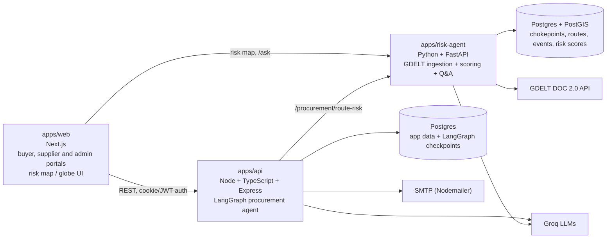

# AI Procurement & Supply Chain Risk Agent

An AI-assisted procurement platform. A buyer describes what they need in plain English, the agent finds supplier quotes, ranks fulfillment plans by price, lead time and deadline fit, and pauses for human approval before anything is ordered. A built-in risk analysis service shows whether the shipping lane between supplier and destination is affected by blockades, conflict or other disruption.

**Live app:** https://procurement-agent-web.vercel.app

---

## What it does

### 1. Sourcing agent (buyer)
- Takes a freeform request, e.g. *"We need 50 units of SanDisk Ultra 64GB microSD card for the hardware team by 2026-10-27."*
- Extracts line items, quantities and the required-by date with an LLM.
- Searches **registered suppliers** (the platform catalog), the **web**, or both.
- Scores every quote on price, lead time and deadline fit, with a **Prioritise** setting (balanced / cheapest / fastest).
- Converts prices to the buyer's currency using live FX rates and includes tax and shipping.
- Builds a **recommended fulfillment plan** (single supplier or split across suppliers) plus alternatives, with a plain-language rationale, e.g. *"Cheapest · fastest · arrives 12d before deadline"*.
- Optionally runs a **supply chain risk check** on the supplier regions in the plan.
- **Always stops for human approval.** The buyer approves the recommended plan, picks an alternative, or rejects.
- After approval, creates and emails RFQs to the chosen suppliers. The UI also offers direct ordering ("Approve & Order") for catalog suppliers.

### 2. Supplier portal
- Suppliers register, build a public profile and manage their product catalog (price, MOQ, lead time, category, tax, certifications).
- They see confirmed orders and their status, and an inbox of RFQs to quote on.
- New suppliers can be reviewed by an admin before going live.

### 3. Route risk analysis
- The user picks an **origin and destination** (typed or on a world map / globe).
- The risk service reports status **per transport mode** (sea, air, road, rail): the chokepoints on the lane, their current risk level (green / yellow / red) and the news events behind it.
- It also answers natural-language questions about current risk (`/ask`).
- Risk data is **advisory**. It never blocks an order and does not change the quote ranking.

### 4. Admin
- Admin login and supplier review/approval.

---

## Architecture



| Part | Stack | Responsibility |
|---|---|---|
| `apps/web` | Next.js, TypeScript, Tailwind | Buyer, supplier and admin UIs; routing/risk visualisation; cart, invoices (PDF), currency display |
| `apps/api` | Express, LangGraph, Drizzle ORM, Postgres, Langfuse, Nodemailer | Auth, catalog, RFQs, orders, FX, and the procurement agent |
| `apps/risk-agent` | FastAPI, psycopg2, Groq, PostGIS | News ingestion, risk scoring, route-risk API, Q&A agent |

### Procurement agent (LangGraph)

```
START → contactSuppliers ─┬─ registered only ─────────────▶ compareQuotes
                          └─ web / both ─▶ webDiscovery ──▶ compareQuotes

compareQuotes ─┬─ no plan (failed / web-only results) ─▶ END
               └─ plan ready ─▶ riskCheck ─▶ humanApproval ─▶ sendRfqs ─▶ END
```

The run state is checkpointed to Postgres (`PostgresSaver`), so a run can wait for approval for minutes or days and survive a server restart.

| Node | What it does |
|---|---|
| `extractRequest` (before the graph, in the route) | LLM (Groq, structured output via Zod) turns free text into line items and a deadline |
| `contactSuppliers` | Full-text search over the supplier catalog (Postgres `tsvector`, listing title only), with an accessory filter so a "case" is not returned for a "Raspberry Pi 5" |
| `webDiscovery` | Runs only when the buyer chose web or both. Finds and extracts quotes from the web, de-duplicates against registered suppliers, and never fails the run |
| `compareQuotes` | Deterministic scoring and plan building (see below) |
| `riskCheck` | Optional. Calls the risk service for each distinct supplier region in the plan and stores the result. Advisory only |
| `humanApproval` | Uses LangGraph `interrupt()`. The run always pauses here |
| `sendRfqs` | Creates and emails one RFQ per supplier (idempotent per task and supplier), reports partial failures |

**Design principles**
- **LLMs only understand intent or write prose.** Anything that must be correct (prices, totals, FX, deadline checks, ranking) is deterministic code.
- **Humans approve every purchase.** No RFQ or order is created before approval.
- **Only verified suppliers can be in a plan.** Web-found quotes are shown for reference (with confidence and source URL) but are never approvable. Simulated suppliers are disabled unless explicitly enabled for demos.
- **Failures degrade gracefully.** Web discovery and risk checks never break a procurement run.

**How `compareQuotes` works**
1. Scores each quote with weight presets for balanced, cheapest or fastest, and a deadline check. Quotes that cannot be fulfilled or priced are excluded.
2. Converts everything to the buyer currency (INR) with stored FX rates, including tax and shipping.
3. Enumerates every one-supplier-per-item combination (capped at 5,000, with a greedy fallback for large item lists).
4. Sorts plans by: meets the deadline, then fewer suppliers, then higher average score, then lower total cost.
5. Returns a recommended plan, alternatives, and a warning if no plan can meet the deadline.

### Risk agent

**Pipeline**
1. `gdelt_ingest.py` queries GDELT for supply-chain-relevant news (blockades, port strikes, sanctions, airspace closures, shipping attacks, canal drought and more).
2. For each article, an LLM (Llama 3.3 70B on Groq) returns structured JSON: relevance, event type, severity (1–5), confidence, likely chokepoint and a summary.
3. Relevant events are stored in `events` and linked to chokepoints.
4. `risk_scoring.py` rolls events up into a **0–100 score per chokepoint**. It uses a 72-hour window, a 24-hour half-life decay, and `severity^1.5 × confidence × decay`. Status is green below 34, yellow from 34 to 66, and red from 67.
5. `procurement_bridge.py` maps an origin and destination to routes and chokepoints and returns the worst status per transport mode.

**Endpoints**

| Method | Path | Purpose |
|---|---|---|
| GET | `/chokepoints`, `/chokepoints/{id}` | Current status, score history, recent events |
| GET | `/routes`, `/routes/{id}/alternatives` | Routes with rolled-up status; alternate routes |
| POST | `/ask` | Natural-language Q&A over live risk data (tool-calling agent) |
| POST | `/procurement/route-risk` | Per-mode risk for a supplier-region → destination lane |
| GET | `/health` | Health check |

### Data model (summary)

- **API database (Drizzle migrations in `apps/api/drizzle`)**: procurers, suppliers, admin, procurement runs, supplier offers (catalog), RFQs and quotes, supplier messages, orders, FX rates, risk assessments. LangGraph checkpoint tables are created at runtime by `PostgresSaver.setup()`.
- **Risk database (`apps/risk-agent/db/schema.sql`, needs PostGIS)**: `chokepoints`, `routes`, `route_chokepoints`, `events`, `event_chokepoints`, `risk_scores`.

---

## Getting started

### Prerequisites
- Node.js 20+
- Python 3.12
- Postgres for the API. Postgres **with PostGIS** for the risk agent.
- A Groq API key.

### 1. Install

```bash
npm install
```

### 2. Configure environment

Create `.env` files from the examples. **Never commit them.**

`apps/api/.env`

| Variable | Purpose |
|---|---|
| `DATABASE_URL` | API Postgres connection string (also used for agent checkpoints) |
| `GROQ_API_KEY` | LLM calls (request extraction, web extraction) |
| `WEB_APP_URL` | Allowed CORS origin (default `http://localhost:3000`) |
| `PORT` | API port (default `3001`) |
| `RISK_AGENT_URL` | Risk service base URL (default `http://localhost:8000`) |
| `PROCUREMENT_REPLY_TO` | Reply-to address on RFQ emails (shared mailbox) |
| `ALLOW_SIMULATED_SUPPLIERS` | `true` enables fake demo quotes. Keep off in production |
| `LANGFUSE_*`, SMTP and JWT settings | Tracing, outgoing mail and auth. See `.env.example` |

`apps/risk-agent/.env`

| Variable | Purpose |
|---|---|
| `DATABASE_URL` | Risk Postgres (PostGIS) connection string |
| `GROQ_API_KEY` | Event extraction and Q&A |

### 3. Set up the databases

```bash
# API database
npm run db:migrate --workspace=apps/api
npm run seed:admin --workspace=apps/api      # creates the first admin

# Risk database (PostGIS required)
psql "$RISK_DATABASE_URL" -f apps/risk-agent/db/schema.sql
```

The risk `routes` and `route_chokepoints` tables are **not populated by `schema.sql`** (it seeds chokepoints only). Add your lanes there, or route-risk lookups will return "no mapped route".

### 4. Run

```bash
# API
npm run dev:api

# Web (new terminal)
npm run dev:web

# Risk agent (new terminal)
cd apps/risk-agent
python -m venv venv && venv\Scripts\activate      # Windows
pip install -r requirements.txt
uvicorn app.main:app --reload --port 8000
```

### 5. Feed the risk agent

Ingestion and scoring are plain scripts. **Schedule them** (cron, Task Scheduler, or your host's cron job), for example every 15–30 minutes:

```bash
cd apps/risk-agent
python -m app.services.gdelt_ingest     # fetch + classify news into events
python -m app.services.risk_scoring     # recompute chokepoint scores
```

If these do not run, risk scores go stale.

### Evals

```bash
npm run eval --workspace=apps/api
```

Deterministic evals cover quote scoring and invoice calculation. The extraction evals call the LLM and are scored rather than exact-matched.

---

## Project structure

```
apps/
├── api/                      Express API + procurement agent
│   ├── src/procurement/      LangGraph graph, nodes, scoring, pricing, FX, web sourcing
│   ├── src/routes/           REST routers (procurement, rfqs, catalog, suppliers, admin, fx, uploads)
│   ├── src/db/               Drizzle schemas and client
│   ├── src/evals/            Evaluation suites
│   └── drizzle/              SQL migrations
├── risk-agent/               FastAPI risk service
│   ├── app/main.py           API endpoints
│   ├── app/services/         gdelt_ingest, risk_scoring, procurement_bridge, agent
│   └── db/schema.sql         PostGIS schema + chokepoint seed
└── web/                      Next.js app
    ├── app/                  Pages: procurement, quotes, rfq, suppliers, admin, routing, supply-chain
    ├── components/           Risk map/globe, RFQ inbox, cart, badges
    └── lib/                  API clients
```

---

## Known limitations

- **Route-to-chokepoint mapping drives risk accuracy.** Results are only as good as the seeded `routes` and `route_chokepoints` data. Some lanes (for example India → Italy) need their chokepoints reviewed. Alternate routes (such as around the Cape of Good Hope) should be added.
- **Risk checks during sourcing need a destination region.** The API's risk client does not always send one, while the risk service requires it, so the check can report "unavailable". Pass the buyer's destination region or make it optional.
- **GDELT events are not de-duplicated**, and `event_time` is the ingestion time, not the article's publish time. Repeated stories can inflate scores.
- **Event classification is headline-only.** The LLM sees the headline and URL, not the article body.
- **Web-sourced quotes are not verified.** They are shown with confidence and source, but cannot be approved or ordered.
- **Catalog matching is full-text search on listing titles.** It has no synonym or fuzzy matching.
- **Risk API has open CORS and no authentication.** Tighten before production.
- **Uploads are stored on local disk** (`apps/api/uploads`), which is lost on redeploy on most hosts. Use object storage.
- **Legacy scheduling-agent code** (`apps/api/src/agent/*`, `routes/runs.ts`, `apps/web/app/runs/*`) is still in the repo and mounted but is not part of the product.

## Roadmap ideas
- Remove the legacy scheduling code and rename the package and repo.
- Use risk as a scored factor in plan ranking, not only as a badge.
- Read supplier email replies back into the system automatically.
- Add article-body analysis and de-duplication to the risk pipeline.
- Scheduler and monitoring for ingestion and scoring.

## Security notes
- Keep `.env`, `cookies.txt` and `eval-output.txt` out of version control, and rotate any key that was ever committed.
- RFQ emails require a real reply-to address. Placeholder `*.local` addresses are rejected.
